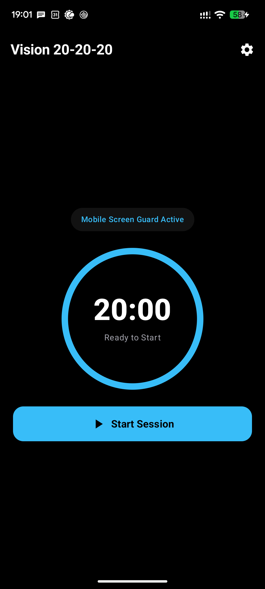
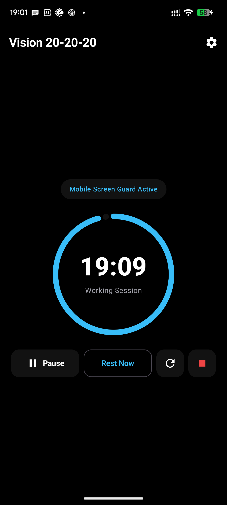
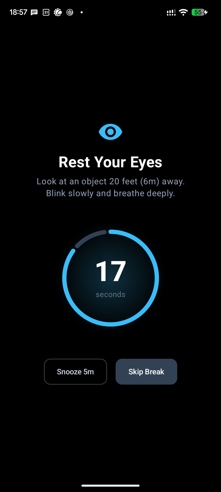
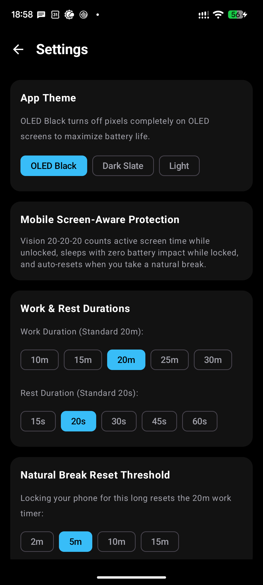

# Vision 20-20-20 👁️

[](https://github.com/xRahul/vision202020/actions/workflows/ci.yml)
[](https://github.com/xRahul/vision202020/releases/latest)
[](https://github.com/xRahul/vision202020/releases)
[](LICENSE)
[](https://developer.android.com/about/versions/oreo)
[](gradle/libs.versions.toml)
[](app/build.gradle.kts)

An open-source, offline, privacy-first native Android eye wellness companion implementing the **20-20-20 Rule**:  
*Every **20 minutes** of screen time, gaze at an object **20 feet** away for at least **20 seconds**.*

---

## Screenshots

| Idle | Working session | Eye-rest break | Settings |
|:---:|:---:|:---:|:---:|
|  |  |  |  |

Captured from the minified release build on a Pixel 7a (Android 17).

---

## Why Vision 20-20-20?

Extended screen time on phones and laptops drastically decreases natural blinking rates from ~18 blinks/min down to ~5 blinks/min, inducing tear film dry spots and chronic ciliary muscle accommodation spasms (**Computer Vision Syndrome / Digital Asthenopia**).

### Key Features
- **Zero Screen Clutter During Work:** While your 20-minute timer counts down, **nothing floats over your apps**. No badges, no floating bubbles, no reading distractions.
- **20-Second Guided Relaxation:** When the work timer completes, a soothing 20-second breathing overlay prompts you to look 20 feet away, blink gently, and relax your ciliary muscles before automatically dismissing itself.
- **Screen-Aware Timer:** Ticks only while your screen is on. Pauses immediately when the screen turns off and auto-resets if your phone stays locked for ≥ 5 minutes (Natural Break).
- **Lock-Screen Alert Delivery:** Wakes up your sleeping display with guided relaxation over keyguard Google Clock-alarm style (`setShowWhenLocked`).
- **Quick Settings Tile:** One-tap toggle directly in your notification shade.
- **Home Screen Widget:** Interactive Jetpack Glance widget showing live remaining time with start/pause/resume controls.
- **Notification-Only Mode:** Optional sound/vibration reminder for users who prefer zero visual blockers.
- **100% Offline & Private:** Zero network permissions (`android.permission.INTERNET` is not included in the manifest). No tracking, no ads.

---

## Downloads & Installation

- **GitHub Releases (recommended):** Download the latest signed release APK from [Releases](https://github.com/xRahul/vision202020/releases/latest).
- **RSS feed:** [releases.atom](https://github.com/xRahul/vision202020/releases.atom)
- **Obtainium:** [add this repository](obtainium://add/https://github.com/xRahul/vision202020) to receive updates directly from GitHub Releases.

F-Droid and IzzyOnDroid listings are not advertised yet. Their badges appear only after the package pages return HTTP 200.

### Verify the APK

Each release from v1.1.8 onward includes a `.sha256` checksum, a CycloneDX `bom.json` SBOM, and a GitHub build-provenance attestation.

```bash
# 1. Check the file digest
sha256sum -c in.rahulja.vision202020-vX.Y.Z-release.apk.sha256

# 2. Verify GitHub built this APK from this repository
gh attestation verify in.rahulja.vision202020-vX.Y.Z-release.apk -R xRahul/vision202020

# 3. Check the signing certificate
apksigner verify --print-certs in.rahulja.vision202020-vX.Y.Z-release.apk
```

Expected signing certificate SHA-256:

```text
9ec14141874c3a8f2e3843f52582c311880fe5417eb6f097fdf8515db92f2511
```

Releases before v1.1.8 predate the checksum and attestation files. Their APKs are still signed with the same release key.

---

## Privacy

- No `android.permission.INTERNET` permission.
- No `android.permission.ACCESS_NETWORK_STATE` permission.
- No ads, analytics, telemetry, or crash-reporting SDK.
- All timer state, preferences, and session data stay on the device.

Android Auto Backup is enabled (`android:allowBackup="true"`). Android may include app preferences in the device's encrypted cloud backup. The app itself never uploads anything. Disable device backup for this app in Android settings if you do not want that.

### Permissions

| Permission | Why it is used |
|---|---|
| `FOREGROUND_SERVICE` | Keeps the interval timer running while you use other apps. |
| `FOREGROUND_SERVICE_SPECIAL_USE` | Declares the timer's special-use foreground service type on Android 14+. |
| `SYSTEM_ALERT_WINDOW` | Draws the 20-second eye-rest overlay above other apps. |
| `POST_NOTIFICATIONS` | Shows the timer notification and break prompts on Android 13+. |
| `USE_FULL_SCREEN_INTENT` | Delivers the lock-screen break alert like an alarm. |
| `RECEIVE_BOOT_COMPLETED` | Restores the timer after a device reboot. |
| `VIBRATE` | Optional vibration reminder. |
| `WAKE_LOCK` | Added by Glance's WorkManager dependency so home-screen widget updates can finish. The app does not acquire wake locks directly. |
| `in.rahulja.vision202020.DYNAMIC_RECEIVER_NOT_EXPORTED_PERMISSION` | App-internal permission for non-exported dynamic receivers. |

---

## Building from Source

### Prerequisites
- JDK 21+
- Android SDK Platform 36 (compileSdk/targetSdk 36, minSdk 26)

```bash
# Clone the repository
git clone git@github.com:xRahul/vision202020.git
cd vision202020

# Run unit tests
./gradlew testDebugUnitTest

# Build debug APK
./gradlew assembleDebug

# Build minified release APK
./gradlew assembleRelease
```

Version code and name are read from `version.properties` (overridable with
`-PversionCode=` / `-PversionName=`), so a shallow clone or source tarball still
builds the correct identity. A release APK is only signed when a keystore is
provided via `KEYSTORE_FILE`/`KEYSTORE_PASSWORD`/`KEY_ALIAS`/`KEY_PASSWORD`;
otherwise Gradle emits an unsigned APK instead of silently using the debug key.

The APKs will be located in:
`app/build/outputs/apk/debug/` and `app/build/outputs/apk/release/`.

---

## License

Vision 20-20-20 is free and open-source software licensed under the **GNU General Public License v3.0** (`GPL-3.0-or-later`). See [LICENSE](LICENSE) for details.

## Security

Report vulnerabilities privately through [GitHub Security Advisories](https://github.com/xRahul/vision202020/security/advisories/new). See [SECURITY.md](SECURITY.md).
